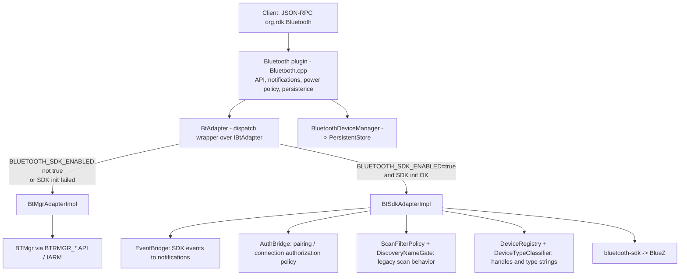

# Bluetooth Plugin: BTMgr and SDK Backends — QA Guide

**Audience:** QA / test engineers validating the `org.rdk.Bluetooth` Thunder plugin.
**Goal:** Explain *what* is being tested, *why*, and *how to approach it*. This is a guide, not a full list of test cases; detailed cases live in the existing test plans linked below.
**Baseline for all comparisons:** the existing implementation on `rdk_develop_branch` (BTMgr-based plugin).

---

## 1. TL;DR

- The Bluetooth plugin used to talk only to **BTMgr** (`BTRMGR_*` C API over IARM). It now ships with a second backend that talks directly to **bluetooth-sdk** (`librdk_bluetooth`, which talks to BlueZ over D-Bus). BTMgr is being retired.
- Both backends live in **one plugin binary**. Which one runs is decided **at runtime** (see [§3.2](#32-how-the-backend-is-chosen)).
- **Nothing about the client-facing contract changes.** Same callsign, same JSON-RPC methods, same notifications, same parameters and response shapes, same device IDs. A client (IUI, apps, scripts) must not be able to tell which backend is running — apart from the short list of **known gaps** in [§5](#5-known-differences-and-gaps-expected-not-new-bugs).
- QA's job is **regression**: run the same scenarios you would run against the `rdk_develop_branch` BTMgr plugin, against **both** backends of this build, and confirm the results match the baseline.
- The SDK backend has to *re-create* a lot of behavior that BTMgr performed silently inside its daemon (scan filtering, auto-accepting connections, startup reconnect, gamepad standby handling, …). These are the highest-risk areas; [§4](#4-what-the-sdk-backend-must-reproduce-and-where-bugs-are-most-likely) lists them and [§6](#6-test-plan) targets them.

### Scope assumption

Testing is limited to **BTMgr → SDK migration regression**. Out of scope for this document:

- New or non-migration functionality.
- The *persistence* migration APIs (`performMigration` / `clearMigration`) and their rollback behavior. Tests here run with `performMigration` **never called** (the default state), which is exactly what the existing [pre-migration regression plan](./bluetooth_pre_migration_regression_test_plan.md) assumes. If you need to test those APIs, use [paired_device_migration_manual_test_plan.md](./paired_device_migration_manual_test_plan.md).

> If "ignore non-migration" was meant differently, check with the dev team before starting; the rest of this guide assumes the interpretation above.

---

## 2. Background: why two backends

| | BTMgr backend (legacy) | SDK backend (new) |
|---|---|---|
| Talks to | BTMgr daemon via `BTRMGR_*` C API + IARM; BTMgr drives BTCore → BlueZ | bluetooth-sdk C++ API (`Manager` / `Adapter` / `Device`) → BlueZ over D-Bus |
| Who owns "smart" behavior (scan filtering, auto-accept, reconnect, gamepad power handling) | BTMgr/BTCore daemon | **The plugin** (it must re-implement it) |
| Events come from | BTRMGR event callback | SDK adapter/device event callbacks |
| Status | Being retired | Target architecture |

Why it matters to QA: with BTMgr, many behaviors were "free" and never visible in the plugin code. With the SDK, the plugin implements them itself, so any gap shows up as a behavior difference.

Background documents:
- [openspec/changes/btmgr-to-sdk-refactor/proposal.md](../openspec/changes/btmgr-to-sdk-refactor/proposal.md) and [design.md](../openspec/changes/btmgr-to-sdk-refactor/design.md) — rationale and design.
- [btmgr-to-sdk-refactor-session-notes.md](./btmgr-to-sdk-refactor-session-notes.md) — implementation notes (some items, e.g. "no BTMgr dependency", predate the dual-backend work and are superseded by the code described here).

---

## 3. How the plugin supports both backends

### 3.1 Architecture

Key points:

- **`Bluetooth.cpp` is the same for both backends.** It implements every JSON-RPC method and notification and only calls the backend-neutral interface `IBtAdapter` ([IBtAdapter.h](../Bluetooth/IBtAdapter.h)) through the `BtAdapter` wrapper ([BtAdapter.cpp](../Bluetooth/BtAdapter.cpp)). The API surface is identical to `rdk_develop_branch` (same methods and notification names).
- `BtMgrAdapterImpl` ([BtMgrAdapterImpl.cpp](../Bluetooth/BtMgrAdapterImpl.cpp)) is the old BTRMGR call sites moved out of `Bluetooth.cpp` with no intended logic change. It is the **reference behavior**.
- `BtSdkAdapterImpl` ([BtSdkAdapterImpl.cpp](../Bluetooth/BtSdkAdapterImpl.cpp)) is the new code, with helpers: `EventBridge`, `AuthBridge`, `ScanFilterPolicy`, `DiscoveryNameGate`, `DeviceRegistry`, `DeviceTypeClassifier`.
- **Device IDs are identical across backends.** `deviceID` is derived from the MAC (strip colons, parse as hex), the same formula BTMgr used. So pairing metadata stored in PersistentStore stays valid regardless of backend.
- Paired-device metadata (`autoconnect`, `lastConnectTimeUtc`, …) is handled by `BluetoothDeviceManager`/PersistentStore, which is backend-independent.

### 3.2 How the backend is chosen

Selection happens when the plugin activates ([BtAdapter.cpp](../Bluetooth/BtAdapter.cpp)):

1. The plugin reads `/etc/device.properties` for `BLUETOOTH_SDK_ENABLED` (value compared case-insensitively to `true`).
2. If it is **`true`**: the plugin tries to initialize the SDK backend.
   - Success → **SDK backend** is used.
   - Failure (no adapter, D-Bus/agent problem, or the SDK library is the "stub") → the SDK is torn down and the plugin **silently falls back to BTMgr** (if BTMgr is built into the image).
3. If the property is **absent or anything other than `true`** → **BTMgr backend**.

Build/product variants you may encounter:

| Variant | Behavior |
|---|---|
| Dual-backend image (BTMgr + SDK present) | Runtime selection as above. This is the main test configuration. |
| SDK-only image (no BTMgr in the build) | Always SDK; the property is irrelevant. If SDK init fails, the **plugin fails to activate** (no fallback). |
| Image with the bundled **stub** SDK | The stub always fails init, so the product behaves as BTMgr (dual build) or fails activation (SDK-only). |

> **Pitfall — silent fallback.** Setting `BLUETOOTH_SDK_ENABLED=true` does **not** guarantee you are testing the SDK. Always confirm the active backend from logs before running a pass ([§6.2](#62-confirm-which-backend-is-active)). A "SDK" run that actually executed on BTMgr is a false pass.

### 3.3 Optional features that interact with backend choice

- `BLUETOOTH_ENABLE_PERSISTENCE_MIGRATION` (compile-time) controls the guarded behaviors described in the pre-migration plan (e.g. `setAutoConnect` rejected, `getAutoConnect` always false until `performMigration`). It is orthogonal to the backend: the same guards apply to both. Confirm the build flag state before testing, since the pre-migration plan assumes it is **ON**.
- `BLUETOOTH_AUDIO_SUPPORT` (compile-time) is currently a build flag only; SDK audio operations are not implemented yet (see [§5](#5-known-differences-and-gaps-expected-not-new-bugs)).

---

## 4. What the SDK backend must reproduce (and where bugs are most likely)

The "same from the client's perspective" requirement is the contract. The table lists the behaviors that BTMgr/BTCore provided internally and that the SDK backend re-implements. Each row is a regression-risk area and is mapped to the test plan in [§6](#6-test-plan).

| # | Behavior (client-visible) | BTMgr (reference) | SDK backend implementation | Test focus |
|---|---|---|---|---|
| 1 | **Device IDs** | `deviceID` from MAC | Same formula (`DeviceRegistry`) | Same MAC → same `deviceID` on both backends |
| 2 | **Device type string** (`deviceType` in lists/events) | BTMgr's mapping; several classes are collapsed (portable/car/hi-fi audio → `LOUDSPEAKER`; all HID subtypes incl. gamepad → `HUMAN INTERFACE DEVICE`) | `DeviceTypeClassifier` from Class of Device / BLE appearance / UUIDs | Strings must match exactly; they also drive connection and auto-accept policy |
| 3 | **Scan results by profile** | btrCore drops devices that don't match the profile; RDK remote controls are hidden when an explicit profile is requested | `ScanFilterPolicy` mirrors the filters | Per-profile scans return the same device classes; RCUs only appear in a default/no-profile scan |
| 4 | **Device naming at discovery** | btrCore waits for a real name: speakers shown after a short wait (may show MAC as name), HID gamepads wait up to ~7 s then show `Game Controller`, others not reported until named | `DiscoveryNameGate` (waits up to ~7 s) | Names shown in `onDiscoveredDevice` / `getDiscoveredDevices` match; no nameless/MAC-named phones etc. |
| 5 | **Discovery lifecycle events** | `DISCOVERY_STARTED` / `DISCOVERY_COMPLETED` etc. | `EventBridge` maps SDK discovery started/stopped; plugin timer still stops scan on timeout | `onStatusChanged` values and counts; scan timeout behavior |
| 6 | **Pair / connect / disconnect / unpair status events and ordering** | Response, then notification | SDK raises events while the call is still blocking, so `EventBridge` **holds** them ~250 ms so the notification arrives *after* the response | Notification always follows the JSON-RPC response; no missing/duplicate `PAIRING_CHANGE` / `CONNECTION_CHANGE` |
| 7 | **Failure reporting** | BTMgr failure events → `onRequestFailed` | SDK has no failure events; plugin uses synchronous call status | Failed pair/connect still produce `onRequestFailed` and a failed response |
| 8 | **Incoming pairing / connection requests** | BTMgr auto-accepts most types; asks the client (`onPairingRequest`, `onConnectionRequest`) for phones/tablets/LE etc. with type-specific answer timeouts (audio ~200 ms, classic gamepad ~2 s, LE gamepad ~20 s) | `AuthBridge` re-implements the policy and timeouts; unanswered requests are rejected | Same events raised for the same device types; `respondToEvent` accepted/rejected is honored; timeouts behave the same |
| 9 | **Startup / power-on reconnect of the last audio device** | BTMgr does it by itself at boot and on power ON | Plugin runs a reconnect pass (`startAutoConnect`): asks the client via `onConnectionRequest` for the most recently used audio device, retries after ~40 s, honors client rejection | Boot and ON-transition reconnect gives the same end result; see pre-migration plan §13 |
| 10 | **Gamepad handling on power state change** | BTMgr: entering STANDBY / LIGHT_SLEEP disconnects non-remote HID devices and suppresses their discovery/reconnect; returning to ON restores them. RCUs are never touched (they wake the box) | `setGamepadStandbyMode` | Gamepads disconnect in standby, do not reconnect until ON, RCU still works |
| 11 | **Adapter power / enable / disable** | BTRMGR adapter calls | SDK `Adapter` power calls + `PoweredOn/Off` events | `enable`/`disable` and resulting `onStatusChanged` |
| 12 | **Persistence** (`autoconnect`, `lastConnectTimeUtc`) | `BluetoothDeviceManager` | Same class; only the BTMgr lookups inside it use the adapter | No PersistentStore or AS-file writes before `performMigration` (pre-migration plan §11) |

---

## 5. Known differences and gaps (expected, not new bugs)

These are **documented gaps in the SDK backend** as of this build. They are *not* parity with BTMgr; record them as "known gap – confirmed" rather than raising new defects, unless the behavior is different from what is listed here. Re-check with the dev team whether any item has since been closed.

| Area | BTMgr backend | SDK backend (current) | Notes |
|---|---|---|---|
| `getName`, `setName` | Works | Returns failure (`unsupported`) | SDK exposes no equivalent for these. Covered by `Bluetooth_Sdk_L2Test.BluetoothGetSetNameUnsupported` |
| `isDiscoverable`, `setDiscoverable` | Works | Returns failure (`unsupported`) | Covered by `Bluetooth_Sdk_L2Test.BluetoothDiscoverableUnsupportedAndScan` |
| Audio: `setAudioStream`, `sendAudioPlaybackCommand`, `getDeviceVolumeMuteInfo`, `setDeviceVolumeMuteInfo`, `getAudioInfo` (track info) | Works | Returns failure / empty (audio support unavailable) | Waiting on SDK `AUDIO_SUPPORT` module |
| Playback / media events (`onPlaybackChange`, `onPlaybackPosition`, `onPlaybackNewTrack`, `onDeviceMediaStatus`, `onPlaybackRequest`) | Emitted | Not emitted | Same dependency as above |
| `activeState` (in device lists) | Real power status | Always `0` | SDK has no power-status property |
| `signalStrength` (in `getDeviceInfo`) | BTMgr signal level | Always `0` (SDK only provides RSSI) | Known gap |
| Gamepad connection handling | BTMgr special cases (gamepad RFC, last-disconnected logic; unpaired gamepad rejected) | Those special cases are **not** mirrored; an unpaired gamepad follows the normal client-escalation flow | Documented in [AuthBridge.h](../Bluetooth/AuthBridge.h) |
| Startup reconnect | Internal to BTMgr (no plugin involvement) | Plugin-driven; if the client accepts the `onConnectionRequest`, the plugin leaves the connect to the client | By design; same end user result expected |

Everything else in the API is expected to behave identically. In particular, the SDK backend is expected to match BTMgr on: scan/stop, discovered/paired/connected lists, pair/unpair, connect/disconnect, `getDeviceInfo` (other than the fields above), `respondToEvent`, `enable`/`disable`, and all non-media notifications.

Also remember the baseline itself has known quirks that **both** backends must preserve (do not file as regressions): e.g. `RESTART` playback command fails on BTMgr, and `DEVICE_DISCONNECT_FAILED` is silently dropped. See [specs/bluetooth-plugin/open-questions.md](../specs/bluetooth-plugin/open-questions.md).

---

## 6. Test plan

### 6.1 Strategy: A/B regression against the baseline

For each scenario:

1. **Baseline (A):** run on `rdk_develop_branch` BTMgr plugin (or use the recorded results if available).
2. **BTMgr backend of this build (B1):** must match A. This verifies the refactor did not change the legacy path.
3. **SDK backend of this build (B2):** must match A, except for the known gaps in [§5](#5-known-differences-and-gaps-expected-not-new-bugs).

Compare *client-visible* outcomes: JSON-RPC response (success flag and payload fields), the notifications received (name, parameters, **order** and relative timing), and observable device behavior (connected/disconnected, audio routed). Internal log differences are not failures.

Suggested result record per case: `A | B1 | B2 | Match? | Known gap? | Notes/log excerpt`.

### 6.2 Confirm which backend is active

Do this at the start of **every** run and after every reboot/plugin restart.

1. Check `/etc/device.properties` for `BLUETOOTH_SDK_ENABLED` (set to `true` for the SDK run; absent/`false` for BTMgr).
2. Activate (or restart) the plugin, then inspect the plugin log:
   - **SDK active:** `BtSdkAdapterImpl::init: exit successfully` appears and `BtAdapter::init: sdkError:` is followed by nothing.
   - **SDK requested but fell back to BTMgr:** `BtAdapter::init: sdkError: <message>` with a non-empty message (e.g. `No Bluetooth adapter found`, `Failed to construct Bluetooth Manager`). **Stop and report** — this is not a valid SDK run.
   - **BTMgr active:** no `BtSdkAdapterImpl` lines at all, and BTMgr is running as a service.
3. Make sure only the intended stack is controlling the Bluetooth hardware (follow your platform's procedure for switching; if unsure, ask dev). Never run both BTMgr and SDK against the same adapter.

### 6.3 Environment and prerequisites

- Dual-backend image with a real SDK (not the stub), reachable device shell and logs.
- Know the build flags (`BLUETOOTH_ENABLE_PERSISTENCE_MIGRATION` ON per the pre-migration plan; `BLUETOOTH_AUDIO_SUPPORT` state).
- `performMigration` never called (verify as in pre-migration plan "Prerequisites", P3).
- A JSON-RPC client (curl against `http://127.0.0.1:9998/jsonrpc`) **and** a way to subscribe to notifications (to observe events and order), since many parity points are event-related.
- Device matrix (as many as available; see [§6.4](#64-device-matrix)):
  at least one headphone/speaker, one RDK remote control, one non-remote HID (keyboard), one gamepad (classic and/or LE), one phone/tablet (for incoming pairing/connection tests), one LE device.

### 6.4 Device matrix

Device class drives type classification, scan filtering, auth policy, power-state handling and reconnect. Cover each class on both backends:

| Class | Why it matters |
|---|---|
| Headphones / speaker / soundbar | `LOUDSPEAKER`/`HEADPHONES` type strings, startup reconnect, ~200 ms connection-request window, audio features |
| RDK remote control | Excluded from profile scans, auto-accepted, never touched on standby |
| Keyboard / non-remote HID | `HUMAN INTERFACE DEVICE`, auto-accept, standby disconnect |
| Gamepad (classic and LE) | Name gating (`Game Controller`), 2 s / 20 s auth windows, standby handling |
| Smartphone / tablet | Incoming pairing/connection escalate to client |
| LE tag/tile | `LE TILE` type, LE scan profile |

### 6.5 Core regression: reuse the existing plan

The primary test cases already exist in [bluetooth_pre_migration_regression_test_plan.md](./bluetooth_pre_migration_regression_test_plan.md) (`TC-PREREG-01` … `26`). That plan was written for "migration-capable firmware where `performMigration` is never called", which is exactly the regression target here. **Run it once per backend** and apply this mapping:

| Pre-migration plan section | What it covers | Run on BTMgr | Run on SDK | Backend notes |
|---|---|---|---|---|
| §1 Baseline/initial state | Boot, store state | Yes | Yes | Add the backend check from [§6.2](#62-confirm-which-backend-is-active) |
| §2 Discovery & scanning | `startScan`/`stopScan`/`getDiscoveredDevices`/events | Yes | Yes | High SDK risk (rows 3–5 in §4). Also run per profile |
| §3 Pairing & unpairing | `pair`/`unpair` | Yes | Yes | Check event order (row 6) |
| §4 Connection management | `connect`/`disconnect` | Yes | Yes | |
| §5 AutoConnect guard | Guard-driven divergence | Yes | Yes | Identical on both backends; **not** a defect |
| §6 Device info, audio & playback | `getDeviceInfo`, `getAudioInfo`, `setAudioStream`, playback commands, `respondToEvent` | Yes | **Partly** | Audio items and `getAudioInfo` are known gaps on SDK; `getDeviceInfo` has the `signalStrength` gap; `respondToEvent` must pass |
| §7 Volume & mute | `get/setDeviceVolumeMuteInfo` | Yes | **Known gap** | Record as known gap on SDK |
| §8 Adapter control | `enable`/`disable`/discoverable/name | Yes | **Partly** | `enable`/`disable` must pass; name/discoverable are known gaps on SDK |
| §9 Gamepad / HID classification | Pair/connect HID and gamepad | Yes | Yes | Type string must be `HUMAN INTERFACE DEVICE` on both |
| §10 Power management guard | `onPowerModeChanged` pre-migration | Yes | Yes | Gamepad standby and reconnect still run (see §6.6) |
| §11 Persistence non-interference | No store/AS-file writes | Yes | Yes | |
| §12 Lifecycle / reboot | Activate/deactivate, reboot | Yes | Yes | |
| §13 Startup reconnect | SDK-driven reconnect | Observe | **Yes (SDK only)** | On BTMgr, only check the end result (last audio device reconnects at boot and on power ON) |

The plan's exit checklist applies to each backend. Its statement that Sections 1–4, 6–9, 11–12 are "identical to a non-migration-capable build" should be read as: identical to the **baseline A**, except for the known gaps above.

### 6.6 Supplemental parity checks (not covered by the existing plan)

The existing plan checks *what the API does*; the following checks target the *behaviors the SDK backend re-created* (§4). Run each on both backends and compare.

| ID | Check | What to compare |
|---|---|---|
| SUP-01 | **Backend selection** | `BLUETOOTH_SDK_ENABLED` true / false / absent / invalid value → expected backend per [§3.2](#32-how-the-backend-is-chosen). With the SDK deliberately unavailable (adapter missing or stub SDK) on a dual image, the plugin falls back to BTMgr and still activates. On an SDK-only image the plugin fails to activate with a clear error |
| SUP-02 | **Switching backends on one unit** | Pair devices under BTMgr, switch to SDK (and back), reactivate: paired devices still listed, same `deviceID`s, `lastConnectTimeUtc`/`autoconnect` data in PersistentStore unaffected |
| SUP-03 | **`deviceID` stability** | Same device → identical `deviceID` on both backends, and identical to the baseline |
| SUP-04 | **Device type strings** | For every device in the matrix, compare `deviceType` in `getDiscoveredDevices`, `getPairedDevices`, `getConnectedDevices`, `getDeviceInfo` and notifications. Pay attention to collapsed types (soundbar/portable/car audio → `LOUDSPEAKER`; keyboard/remote/gamepad → `HUMAN INTERFACE DEVICE`) |
| SUP-05 | **Scan profiles** | Run `startScan` with each supported profile (default/none, audio output, smartphone/tablet, HID, audio+HID, LE). Compare the sets of devices found. RCUs must appear only with no/unrecognized profile. Stop and timeout behavior (`timeout` values incl. ≤0) |
| SUP-06 | **Discovery name behavior** | Power up devices that advertise without a name (speaker, gamepad, phone). Compare names shown, delay before they appear (SDK waits up to ~7 s), and that gamepads show as `Game Controller` when unnamed |
| SUP-07 | **Notification order and content** | For `pair`, `unpair`, `connect`, `disconnect`, `enable`, `disable`: record the response and the notifications (`onStatusChanged` with `newStatus`, `paired`, `connected`, …). The notification must come **after** the response; no duplicates; none missing. Discovery: `DISCOVERY_STARTED`/`DISCOVERY_COMPLETED`, `onDiscoveredDevice` (FOUND/LOST/updates), `onDeviceFound`, `onDeviceLost` |
| SUP-08 | **Failure paths** | Pair/connect with a device that is off, out of range, or rejects; pair an already-paired device; connect an unpaired device; unknown `deviceID`. Compare success flag and `onRequestFailed` events |
| SUP-09 | **Incoming requests (device initiates)** | Pair/connect from a phone/tablet: `onPairingRequest`/`onConnectionRequest` raised, `respondToEvent` accept and reject honored, no answer → rejected after the type's window. Repeat for headphones (client asked, short ~200 ms answer window), RCU/keyboard (auto-accepted when paired), classic gamepad (~2 s window), LE gamepad (~20 s window). Compare against baseline A rather than assuming the values |
| SUP-10 | **Gamepad standby/wake** | With a gamepad and an RCU connected, move the box to STANDBY and LIGHT_SLEEP: gamepad disconnects and does not reconnect or show up in discovery; RCU stays connected. Return to ON: gamepad can reconnect and is reported. DEEP_SLEEP and OFF should not by themselves change the gamepad mode |
| SUP-11 | **Power-on reconnect (user view)** | With an audio device that was used last, reboot and also ON-transition from standby: the same device reconnects automatically on both backends within a comparable time; if another audio output device is already connected, nothing extra is connected |
| SUP-12 | **Adapter enable/disable cycling** | Repeat `disable`/`enable` several times while devices are paired; lists and notifications stay consistent; powered-off adapter doesn't produce stale connected devices |
| SUP-13 | **Plugin lifecycle under load** | Activate/deactivate 10+ times with and without a scan running or an auth request pending; no hang, crash or leaked threads; reboot stability |
| SUP-14 | **Concurrency** | Issue `connect` and `startScan` (or two device operations) close together, and a client `connect` immediately after a startup reconnect request; no deadlock, no "In Progress" error for an accepted flow |
| SUP-15 | **Soak** | Several hours with periodic scan/pair/connect/disconnect cycles; monitor memory and CPU of the plugin process and look for D-Bus/IARM errors |

### 6.7 Automated tests to run alongside manual testing

These are developer-level suites; QA should confirm they pass in CI for the build under test and use them as evidence.

- **L1** ([test_Bluetooth.cpp](../Tests/L1Tests/tests/test_Bluetooth.cpp)) — plugin logic with a mocked `IBtAdapter`; backend-agnostic.
- **L2, BTMgr harness** ([Bluetooth_L2Test.cpp](../Tests/L2Tests/tests/Bluetooth_L2Test.cpp)) and **L2, SDK harness** ([Bluetooth_Sdk_L2Test.cpp](../Tests/L2Tests/tests/Bluetooth_Sdk_L2Test.cpp), including `StartupReconnect_*`, one of which takes ~41 s). Both backends are compiled in test builds; `BLUETOOTH_TEST_BACKEND` (BTMGR or SDK) selects the L2 harness.
- Details: [bluetooth-l1-tests.md](./bluetooth-l1-tests.md), [Tests/README.md](../Tests/README.md).

### 6.8 Pass / fail criteria and defect triage

A case **passes** when the B1 and B2 client-visible results match baseline A (response payload, notification set and order, device behavior), allowing only the documented gaps in [§5](#5-known-differences-and-gaps-expected-not-new-bugs).

File a defect (tag with backend: `BTMgr` / `SDK` / `Both`) when:

- B1 differs from A → regression in the legacy path (refactor bug).
- B2 differs from A and it is **not** in §5 → SDK parity bug. Highest value: unsupported/silent gap, wrong type string, missing/duplicate/out-of-order notification, wrong auth outcome, reconnect or standby behavior not matching.
- B2 differs from A in a way that §5 lists but **worse** than described (e.g. crash instead of a failure response) → defect.
- Plugin fails to activate, silently selects the wrong backend, or both stacks fight over the adapter.

Do **not** file: results listed in §5; the documented guard-driven results of the pre-migration plan (§5 there); pre-existing quirks present in baseline A.

Include in each report: backend (and how you verified it), build/flags, device model/class, JSON-RPC request/response, notification trace, plugin log excerpt with timestamps.

### 6.9 Exit criteria

- [ ] Backend identity verified at the start of every run ([§6.2](#62-confirm-which-backend-is-active)).
- [ ] Pre-migration regression plan executed on **both** backends; results recorded as A/B1/B2.
- [ ] SUP-01 … SUP-15 executed on both backends (SUP-01/02 as applicable to the image type).
- [ ] Every B2 difference is either a §5 known gap or a filed defect.
- [ ] No PersistentStore or AS-file writes during the pass; `performMigration` never called.
- [ ] No crashes, hangs or unexpected error logs on either backend.
- [ ] L1/L2 suites green for the build under test.

---

## 7. References

| Document | Use |
|---|---|
| [bluetooth_pre_migration_regression_test_plan.md](./bluetooth_pre_migration_regression_test_plan.md) | Core regression cases (run per backend) |
| [paired_device_migration_manual_test_plan.md](./paired_device_migration_manual_test_plan.md) | Persistence migration/rollback (out of scope here) |
| [bluetooth-l1-tests.md](./bluetooth-l1-tests.md) | L1/L2 automated test overview |
| [Bluetooth/README.md](../Bluetooth/README.md) | API methods, responses, events |
| [openspec/changes/btmgr-to-sdk-refactor/](../openspec/changes/btmgr-to-sdk-refactor/) | Design intent and dispatch/event/auth tables |
| [specs/bluetooth-plugin/spec.md](../specs/bluetooth-plugin/spec.md) | Behavioral specification of the plugin |
| [specs/bluetooth-plugin/open-questions.md](../specs/bluetooth-plugin/open-questions.md) | Baseline quirks and open decisions |
| [Bluetooth/IBtAdapter.h](../Bluetooth/IBtAdapter.h), [BtAdapter.cpp](../Bluetooth/BtAdapter.cpp) | The backend interface and selection logic |

### Open items for the dev team to confirm before QA starts

1. The supported procedure for switching a unit between BTMgr and SDK (which services to stop/start besides toggling `BLUETOOTH_SDK_ENABLED` and restarting the plugin).
2. Whether the §5 gaps (name/discoverable, audio, `activeState`, `signalStrength`) are accepted for this release or are blockers.
3. Which flag configuration (`BLUETOOTH_ENABLE_PERSISTENCE_MIGRATION`, `BLUETOOTH_AUDIO_SUPPORT`) the build under test uses.
